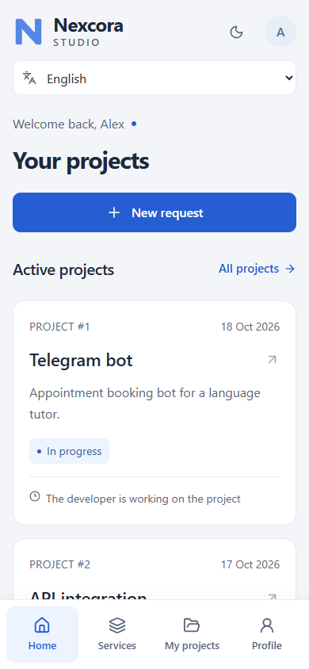
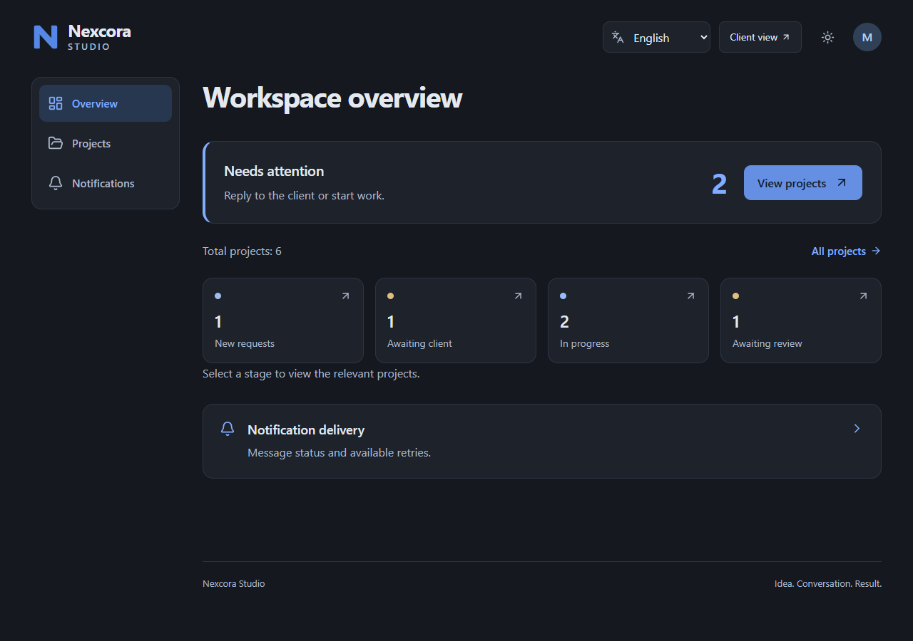
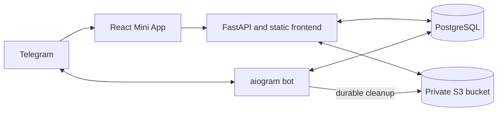

# Nexcora Studio

[](https://github.com/Dxniar/nexcora-studio/actions/workflows/checks.yml)

A Telegram Mini App for managing freelance projects from the first request to final acceptance.

Clients submit a brief, agree on a versioned proposal and follow delivery. The owner manages a shared project queue, publishes updates and handles revisions. A Telegram bot opens the workspace and delivers project notifications.

[Open the Telegram demo](https://t.me/nexcora_bot) · [Portfolio case study](PORTFOLIO.md) · [Local setup](docs/development.md) · [Deployment guide](docs/deployment.md)

The hosted demo includes the English, Russian and Kazakh interfaces.

## Interface

| Client workspace · mobile                                                                                                        | Owner dashboard · desktop                                                                                                           |
| -------------------------------------------------------------------------------------------------------------------------------- | ----------------------------------------------------------------------------------------------------------------------------------- |
|  |  |

Screenshots use synthetic test data in a local fixture. Names, projects and counts are examples, not customer records or business metrics.

## Product workflow

**Request → discussion → proposal → agreement → work → delivery → acceptance**

| Client workspace                                             | Owner workspace                                                   |
| ------------------------------------------------------------ | ----------------------------------------------------------------- |
| Service catalogue and a server-saved request draft           | Project queue with search, filters and pagination                 |
| Private brief attachments and a review before submission     | Versioned scope, deliverables, price, deadline and revision terms |
| Personal projects, status and project history                | Work starts after the client accepts the current proposal         |
| Accept a proposal or request changes                         | Progress updates and delivery by text and HTTPS link              |
| Accept delivery or request a revision with a comment         | Close a request with a reason and inspect failed notifications    |
| Notification preferences and confirmed account-data deletion | Client preview that preserves server-enforced owner permissions   |

Russian, English and Kazakh interfaces share a saved account language across the bot and Mini App. The bot exposes `/language`; the Mini App includes its own selector. Project descriptions, names and uploaded documents remain as written by their authors.

## Engineering decisions

- **Server-side identity and ownership.** Telegram `initData` is validated before creating a time-limited session. Owner access is derived from the configured Telegram ID; browser-supplied role flags do not grant access.
- **Explicit project changes.** Version checks reject stale edits. Idempotency keys prevent repeated requests from duplicating business actions. Budget and deadline wishes in a brief stay separate from agreed proposal terms.
- **Durable background work.** Project changes commit independently of Telegram delivery. Leased notification and file-cleanup jobs survive restarts, with bounded retries and an owner-visible failure queue.
- **Private attachments.** S3 objects remain private. The API checks project access when serving a download, validates the actual file size and format, and records a SHA-256 checksum.
- **Responsive interface.** Mobile and desktop layouts, light and dark themes, Telegram safe areas, keyboard navigation and enlarged-text scenarios are included in browser checks.

## Architecture



The web service serves the built frontend and API from one origin. A separate bot process runs polling, notification delivery and file cleanup against the same database. Only one poller may hold the advisory lock for a bot token. Production requires PostgreSQL, an HTTPS origin and configured private object storage.

| Layer           | Technology                                                 |
| --------------- | ---------------------------------------------------------- |
| Backend         | Python 3.14, FastAPI, SQLAlchemy, Alembic                  |
| Bot and workers | aiogram 3, PostgreSQL-backed outbox and cleanup queues     |
| Frontend        | React, TypeScript, Vite, Lucide icons                      |
| Data and files  | PostgreSQL, private S3-compatible storage                  |
| Packaging       | Multi-stage Docker image; separate web and bot processes   |
| Verification    | Python unittest, disposable PostgreSQL schemas, Playwright |

Runtime Python dependencies are pinned in [`requirements.lock`](requirements.lock), and frontend dependencies in [`web/package-lock.json`](web/package-lock.json). The Docker build uses Python 3.14 and Node.js 24.

## Run locally

The full Windows setup, environment-variable reference, test commands and Docker options are in [Development](docs/development.md).

```powershell
py -3.14 -m venv .venv
.\.venv\Scripts\python.exe -m pip install -r requirements.lock
npm.cmd --prefix web ci
npm.cmd --prefix web run build
if (-not (Test-Path -LiteralPath .env)) { Copy-Item .env.example .env }
```

Configure your own bot, development PostgreSQL and private storage in `.env`, then apply migrations before starting the web service and bot. Never replace an existing `.env` or use production credentials in tests.

Opening the web URL in a regular browser shows the Telegram entry screen. Authentication has no local demo-user bypass. The browser test harness uses signed synthetic identities against a separate temporary application and database.

## Verification

```powershell
.\.venv\Scripts\python.exe -m unittest discover -s tests -v
.\.venv\Scripts\python.exe -m pip check
npm.cmd --prefix web run typecheck
npm.cmd --prefix web run build
npm.cmd --prefix web run test:e2e
```

Without `TEST_DATABASE_URL`, PostgreSQL-specific tests are skipped. Use a dedicated database named `nexcora_test` for transaction, locking, migration and restore checks; the suite creates disposable schemas and temporary databases. See [the test setup](docs/development.md#verification) before enabling these tests.

The [GitHub Actions workflow](.github/workflows/checks.yml) defines offline Python checks on Linux and Windows, PostgreSQL integration and restore checks, frontend type checking, browser flows and a container build. Its configuration does not imply a successful CI run; check the repository's Actions results after publishing.

## File and privacy boundaries

- Up to **5 files**, **10 MiB per file**, **50 MiB total** per initial request.
- Accepted extensions: `.txt`, `.pdf`, `.doc`, `.docx`, `.jpg`, `.jpeg`, `.png`, `.webp`.
- Attachments can be added or removed before submission; the submitted set is fixed.
- Format validation is not a malware-scanning guarantee.
- Confirmed data deletion revokes access and schedules physical object cleanup. Previously sent Telegram messages and independent backups are not automatically withdrawn.
- A lost Telegram response can cause a notification to be delivered again; it does not repeat the project operation.

## Release boundaries

Online payments, an AI chat, multiple assignees and marketplace matching are outside the current release. Accepting a proposal does not mean payment has been collected.

The hosted demo uses Railway for the web service, bot, PostgreSQL and private bucket. Real Telegram owner sign-in has been user-confirmed. A complete live client journey, routine backup schedules, restore procedures with actual customer files and proxy/IP configuration require operator validation before accepting production work. Automated tests use synthetic data and do not establish commercial adoption or production capacity.

## Repository map

```text
nexcora_studio/   API, services, bot and background workers
web/             React interface and browser tests
migrations/      Alembic database migrations
tests/           Offline and PostgreSQL integration tests
orderbot/        Earlier bot and shared catalogue/import support
docs/            Development and deployment documentation
assets/branding/ Vector brand assets
```

The current application starts with `python -m nexcora_studio`; the current bot with `python -m nexcora_studio.bot`. The earlier `orderbot` entry point is retained for historical compatibility and is not the current Mini App backend.
